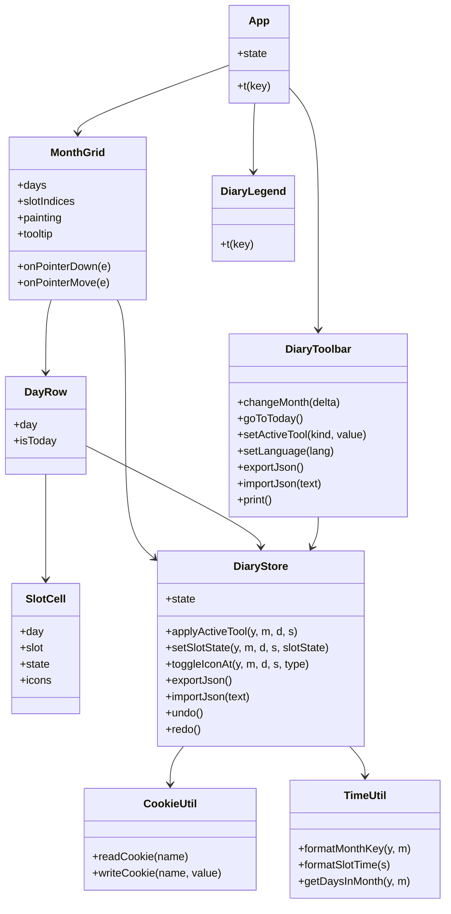
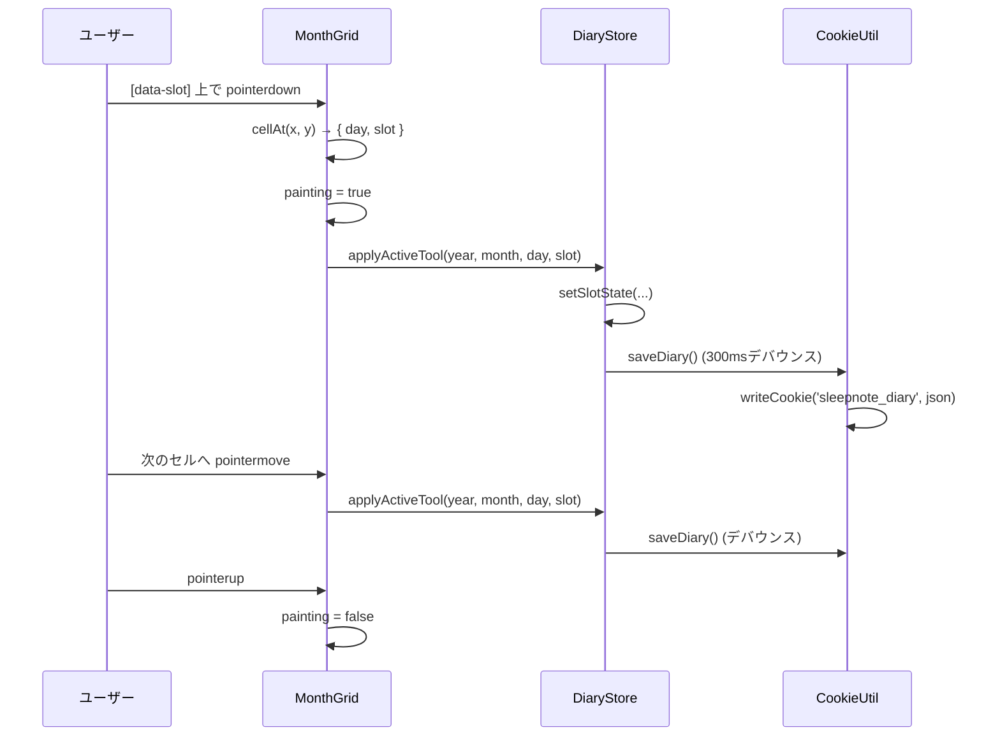

# SleepNote — アーキテクチャ

## コンポーネントツリー

```
App.vue
├── DiaryToolbar.vue   — 月移動・塗りツール・アイコン・JSON/PDF・言語切り替え
├── MonthGrid.vue      — 月ボード（時刻ヘッダー + 日行）。ドラッグ塗りとツールチップを処理
│   └── DayRow.vue     — 1日分: 日付ラベル + 48スロットのセル
│       └── SlotCell.vue — 30分1スロット: 塗りパターン + 任意のアイコン
└── DiaryLegend.vue    — 塗りパターンとアイコンの凡例
```

## データモデル

日誌全体は1つのJSONドキュメントで、Cookieへの保存とファイル書き出しの両方に使われます。

```json
{
  "version": 1,
  "months": {
    "2026-11": {
      "slots": { "5": "..SSSSAAD...SSSS..." },
      "icons": [ { "day": 5, "slot": 8, "type": "medication" } ]
    }
  }
}
```

- `version` — スキーマのバージョン（現在 `1`）。
- `months` — `"YYYY-MM"`（`TimeUtil.formatMonthKey` が生成）をキーとする。
- `slots` — 日番号の文字列をキーとし、値は48文字の行（30分スロットごとに1文字）。
- `icons` — `{ day, slot, type }` の配列。`type` は `medication` または `meal`。

スロット文字（`DiaryConstants`）:

| 文字 | 状態       |
| ---- | ---------- |
| `.`  | 空         |
| `S`  | 睡眠       |
| `A`  | 在床覚醒   |
| `D`  | 活動中眠気 |

## 状態管理

`Composables/DiaryStore.js` は `useDiaryStore()` をエクスポートし、モジュールレベルの `reactive` シングルトンを返します。これを呼ぶすべてのコンポーネントが同じ `state` オブジェクトを共有するため、props/イベントや状態管理ライブラリなしで全ビューが同期します。

`state` が保持するもの:

- `viewYear` / `viewMonth` — 表示中の月（`viewMonth` は0始まり）。
- `language` — `en` または `ja`。
- `activeTool` — `{ kind, value }`。`kind` は `state`（睡眠 / 在床覚醒 / 活動中眠気。消しゴムは Empty に対応）または `icon`（服薬 / 食事）。
- `diary` — 上記のドキュメント。
- `notice` — 一時的なステータスメッセージ。

永続化: すべての変更は `saveDiary()` を呼び、300msデバウンス後に `JSON.stringify(state.diary)` を `CookieUtil.writeCookie` で `sleepnote_diary` Cookieへ書き込みます。起動時は `loadDiary()` がこのCookieを読み込んでパースし、エラー時は空の日誌にフォールバックします。言語は `sleepnote_language` に即時保存されます。

## 操作フロー

- **ドラッグ塗り** — `MonthGrid` はボード上の `pointerdown` / `pointermove` / `pointerup` / `pointerleave` を監視します。セル（`[data-slot]`）上での `pointerdown` はアクティブなツールを適用し、状態ツールなら `painting = true` に設定します。`painting` 中は `pointermove` で通過した全セルにツールを適用し、ドラッグしながら連続して塗れます。アイコンツールは単発クリックで適用されます（ドラッグなし）。
- **アイコンのトグル** — アイコンツール選択中にスロットをクリックすると `toggleIconAt` が呼ばれ、無ければ追加、あれば削除します。
- **ツールチップ** — `pointermove` で `MonthGrid` は `document.elementFromPoint` によりホバー中のセルを特定し、`11/5 (水) 04:00` のようなツールチップを表示します。
- **元に戻す / やり直す** — ストアはスナップショット履歴（`past` / `future` スタック）を保持し、500ms以内の連続した変更（ドラッグ）は1つのUndoステップにまとめます。ツールバーのボタンと Ctrl+Z / Ctrl+Shift+Z で操作します。

## PDF / 印刷

PDFはライブラリではなくブラウザの印刷ダイアログ（PDFに保存）で生成します。`DiaryToolbar` が `window.print()` を呼び出します。`src/assets/main.css` の `@media print` ブロックは `@page { size: A4 landscape; margin: 10mm }` を定義し、`.no-print` 要素（ヘッダー・ツールバー・凡例・警告）を非表示にして、月ボードだけが印刷されるようグリッドの枠線とオーバーフローを整えます。`print-color-adjust: exact` で背景の塗りを強制し、3つのパターン（塗りつぶし / 斜線ハッチ / ドット）はモノクロ印刷でも区別できるよう設計されています。

## クラス図



## ドラッグ塗りのシーケンス


