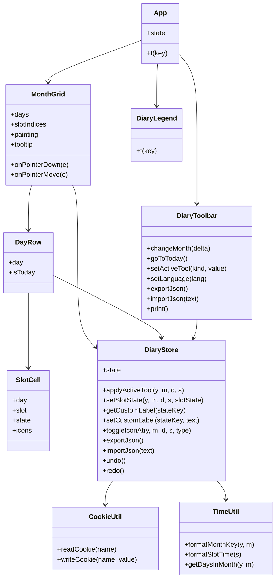

# SleepNote — アーキテクチャ

## コンポーネントツリー

```
App.vue
├── DiaryToolbar.vue   — 月移動・塗りツール・アイコン・JSON/PDF・言語切り替え
├── MonthGrid.vue      — 月ボード（時刻ヘッダー + 日行）。ドラッグ塗りとツールチップを処理
│   └── DayRow.vue     — 1日分: 日付ラベル + 睡眠時間合計(HH:MM) + 48スロットのセル
│       └── SlotCell.vue — 30分1スロット: 塗りパターン + 任意のアイコン
└── DiaryLegend.vue    — 塗りパターンとアイコンの凡例
```

## データモデル

日誌全体は1つのJSONドキュメントで、Cookieへの保存とファイル書き出しの両方に使われます。

```json
{
  "version": 1,
  "customLabels": { "custom1": "カフェイン" },
  "months": {
    "2026-11": {
      "slots": { "5": "..SSSSAAD...SSSS..." },
      "icons": [ { "day": 5, "slot": 8, "type": "medication" } ],
      "notes": { "5": "15時にカフェイン" }
    }
  }
}
```

- `version` — スキーマのバージョン（現在 `1`）。
- `customLabels` — カスタム塗り3種（`custom1`〜`custom3`）のユーザー定義名。キーが無ければローカライズ済みの既定名を使う（任意。古いデータには存在しない）。
- `months` — `"YYYY-MM"`（`TimeUtil.formatMonthKey` が生成）をキーとする。
- `slots` — 日番号の文字列をキーとし、値は48文字の行（30分スロットごとに1文字）。
- `icons` — `{ day, slot, type }` の配列。`type` は `medication`、`meal`、または `coffee`。
- `notes` — 日番号の文字列をキーとし、値は1行の備考テキスト（任意。古いデータには存在しない）。

スロット文字（`DiaryConstants`）:

| 文字 | 状態       | 種別             |
| ---- | ---------- | ---------------- |
| `.`  | 空         | —                |
| `S`  | 睡眠       | 固定の塗り       |
| `A`  | 在床覚醒   | 固定の塗り       |
| `D`  | 活動中眠気 | 固定の塗り       |
| `1`  | カスタム1  | ユーザー定義の塗り |
| `2`  | カスタム2  | ユーザー定義の塗り |
| `3`  | カスタム3  | ユーザー定義の塗り |

## 状態管理

`Composables/DiaryStore.js` は `useDiaryStore()` をエクスポートし、モジュールレベルの `reactive` シングルトンを返します。これを呼ぶすべてのコンポーネントが同じ `state` オブジェクトを共有するため、props/イベントや状態管理ライブラリなしで全ビューが同期します。

`state` が保持するもの:

- `viewYear` / `viewMonth` — 表示中の月（`viewMonth` は0始まり）。
- `language` — `en` または `ja`。
- `activeTool` — `{ kind, value }`。`kind` は `state`（睡眠 / 在床覚醒 / 活動中眠気 / ユーザー定義の塗り3種。消しゴムは Empty に対応）または `icon`（服薬 / 食事 / コーヒー）。
- `diary` — 上記のドキュメント。
- `notice` — 一時的なステータスメッセージ。

永続化: すべての変更は `saveDiary()` を呼び、300msデバウンス後に `JSON.stringify(state.diary)` を `CookieUtil.writeCookie` で `sleepnote_diary` Cookieへ書き込みます。起動時は `loadDiary()` がこのCookieを読み込んでパースし、エラー時は空の日誌にフォールバックします。古いドキュメントや読み込んだファイルは `normalizeDiary()` が `customLabels` などの不足フィールドを補完します。言語は `sleepnote_language` に即時保存されます。

## 操作フロー

- **ドラッグ塗り** — `MonthGrid` はボード上の `pointerdown` / `pointermove` / `pointerup` / `pointerleave` を監視します。セル（`[data-slot]`）上での左ボタン `pointerdown` はアクティブなツールを適用し、状態ツールなら開始した日（`paintDay`）を記録して `painting = true` に設定します。`painting` 中は `pointermove` で通過したセルにツールを適用しますが、ドラッグを開始した日（行）の中だけで、誤って他の日へドラッグしても塗られません。アイコンツールは単発クリックで適用されます（ドラッグなし）。
- **右クリックで消去** — 塗ったスロットを右クリック（`contextmenu`）すると塗りを `Empty` に戻します（消しゴムツールと同じ）。ボード上ではブラウザ標準のコンテキストメニューを抑止します。
- **アイコンのトグル** — アイコンツール選択中にスロットをクリックすると `toggleIconAt` が呼ばれ、無ければ追加、あれば削除します。
- **睡眠時間の合計** — 各 `DayRow` は自分の日の `S`（睡眠）スロット数を数え、日付ラベルの次の列に `HH:MM` で表示します。ストアから毎回計算されるため、塗り操作・元に戻す/やり直しに即時追従します。カウントするのは固定の睡眠塗りのみで、在床覚醒・活動中眠気・カスタム塗りは含みません。
- **ホバーのクロスヘア** — `pointermove` で `MonthGrid` は `document.elementFromPoint` によりホバー中のセルを特定し、`11/5 (水) 04:00` のようなツールチップを表示します。さらに、ホバー中のセルの行と列を薄くハイライトします（該当日の行と該当スロットの列のセルに `slot-cell--highlight` オーバーレイを付与）。
- **元に戻す / やり直す** — ストアはスナップショット履歴（`past` / `future` スタック）を保持し、500ms以内の連続した変更（ドラッグ）は1つのUndoステップにまとめます。ツールバーのボタンと Ctrl+Z / Ctrl+Shift+Z で操作します。

## スマホとタッチ操作

- **レイアウト** — 640px未満では見出し・合計・備考の列が縮み、スロットは高さ22pxになり、盤面は横スクロールします。日付・睡眠時間・備考の列はスクロール中も左右に固定されます。
- **タッチは既定でスクロール** — `.diary-board` は `touch-action: pan-x pan-y` を使います。ブラウザがスクロールに入らなかったタッチだけをタップとみなします。`MonthGrid` は `pointerup` で塗りを適用し、`pointercancel` で保留中のタップを破棄するため、スワイプでは塗られません。現在の塗りと同じ塗りのスロットをタップすると消えます（`DiaryStore.tapActiveTool`）。そのため2回タップすると塗りがトグルで消えます。
- **ドラッグ塗りの切り替え** — `state.touchDragPaint`（UIのみ、保存しない）はタッチ端末（`pointer: coarse`）でのみ表示します。ONのときは盤面が `touch-action: none` になり、指のドラッグでマウスと同じように塗れます。OFFのときは盤面をスクロールできます。
- **入力時のズーム防止** — スマホでは備考欄を16pxにし、フォーカス時にiOSがズームしないようにしています。

## カラーテーマ

色はすべて `src/assets/main.css` のCSSカスタムプロパティに集約しています。`:root` にライト配色と塗りの色を定義し、`@media screen and (prefers-color-scheme: dark)` のブロックでOSの設定に応じて上書きします。上書きは `screen` のみなので、印刷時は常にライト配色になります。コンポーネントは `var(--color-*)` と `var(--fill-*)` を参照し、色を直接書きません。

## PDF / 印刷

PDFはライブラリではなくブラウザの印刷ダイアログ（PDFに保存）で生成します。`DiaryToolbar` が `window.print()` を呼び出します。`src/assets/main.css` の `@media print` ブロックは `@page { size: A4 landscape; margin: 10mm }` を定義し、`.no-print` 要素（ヘッダー・ツールバー・警告）を非表示にし、月ボードにコンパクトな凡例を添えて1ページ（A4）に収まるようグリッドの枠線とオーバーフローを整えます。`print-color-adjust: exact` で背景の塗りを強制し、6つのパターン（塗りつぶし / 斜線ハッチ / ドットに加え、カスタム塗りのクロスハッチ / 縦縞 / チェッカー）はモノクロ印刷でも区別できるよう設計されています。

## クラス図



## ドラッグ塗りのシーケンス

```mermaid
sequenceDiagram
    participant U as ユーザー
    participant M as MonthGrid
    participant S as DiaryStore
    participant C as CookieUtil

    U->>M: [data-slot] 上で pointerdown
    M->>M: cellAt(x, y) → { day, slot }
    M->>M: painting = true; paintDay = day
    M->>S: applyActiveTool(year, month, day, slot)
    S->>S: setSlotState(...)
    S->>C: saveDiary() (300msデバウンス)
    C->>C: writeCookie('sleepnote_diary', json)

    U->>M: 同じ日（行）の中で pointermove
    M->>S: applyActiveTool(...)（day == paintDay のときのみ）
    S->>C: saveDiary() (デバウンス)

    U->>M: pointerup
    M->>M: painting = false; paintDay = null
```
