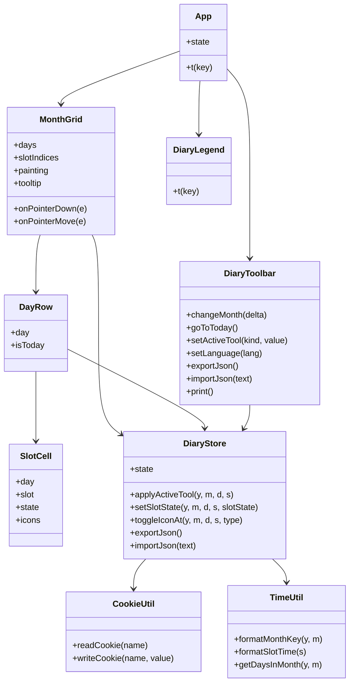
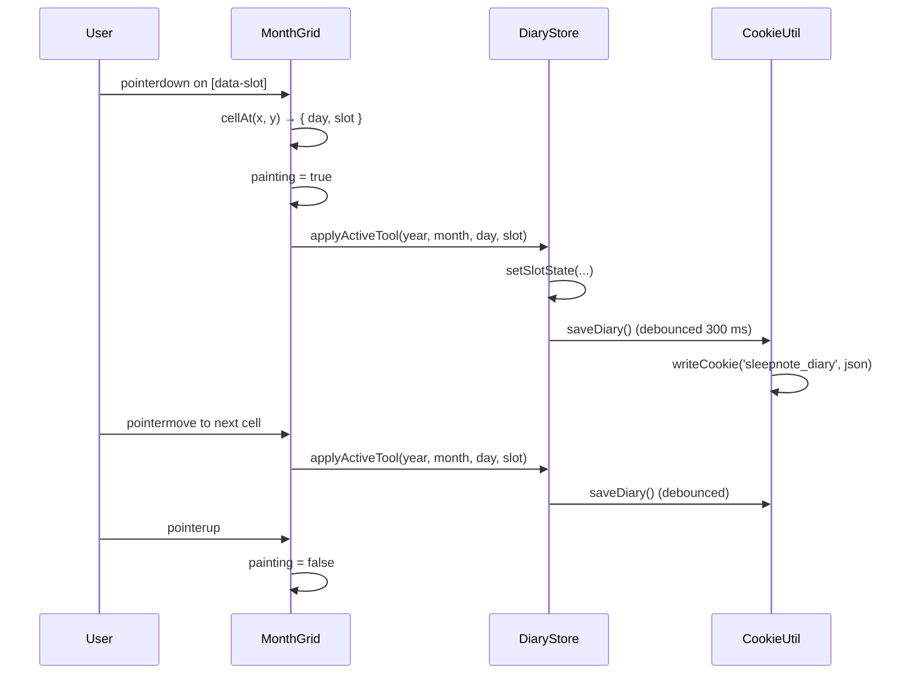

# SleepNote — Architecture

## Component tree

```
App.vue
├── DiaryToolbar.vue   — month navigation, paint tools, icons, JSON/PDF, language toggle
├── MonthGrid.vue      — month board (hour header + day rows); handles drag-paint and tooltip
│   └── DayRow.vue     — one day: date label + 48 slot cells
│       └── SlotCell.vue — one 30-minute slot: fill pattern + optional icons
└── DiaryLegend.vue    — legend of fill patterns and icons
```

## Data model

The whole diary is a single JSON document, serialized to a cookie and to exported files.

```json
{
  "version": 1,
  "months": {
    "2026-11": {
      "slots": { "5": "..SSSSAAD...SSSS..." },
      "icons": [ { "day": 5, "slot": 8, "type": "medication" } ]
    }
  }
}
```

- `version` — schema version, currently `1`.
- `months` — keyed by `"YYYY-MM"` (from `TimeUtil.formatMonthKey`).
- `slots` — keyed by the day number as a string; each value is a 48-character row, one character per 30-minute slot.
- `icons` — array of `{ day, slot, type }`; `type` is `medication` or `meal`.

Slot characters (`DiaryConstants`):

| Char | State              |
| ---- | ------------------ |
| `.`  | Empty              |
| `S`  | Sleep              |
| `A`  | Awake in bed       |
| `D`  | Daytime sleepiness |

## State management

`Composables/DiaryStore.js` exports `useDiaryStore()`, which returns a module-level `reactive` singleton. Every component that calls it shares the same `state` object, so all views stay in sync without props/events or a state library.

`state` holds:

- `viewYear` / `viewMonth` — the visible month (`viewMonth` is 0-based).
- `language` — `en` or `ja`.
- `activeTool` — `{ kind, value }`; `kind` is `state` (Sleep / Awake in bed / Daytime sleepiness, with Eraser mapped to Empty) or `icon` (medication / meal).
- `diary` — the document described above.
- `notice` — a transient status message.

Persistence: every mutation calls `saveDiary()`, which debounces (300 ms) a write of `JSON.stringify(state.diary)` to the `sleepnote_diary` cookie via `CookieUtil.writeCookie`. On startup, `loadDiary()` reads and parses that cookie, falling back to an empty diary on any error. The language is persisted immediately to `sleepnote_language`.

## Interaction flow

- **Drag paint** — `MonthGrid` listens for `pointerdown` / `pointermove` / `pointerup` / `pointerleave` on the board. A `pointerdown` on a cell (`[data-slot]`) applies the active tool and, for state tools, sets `painting = true`. While `painting`, `pointermove` applies the tool to every cell entered, enabling continuous drag painting. Icon tools apply on a single click (no drag).
- **Icon toggle** — with an icon tool active, clicking a slot calls `toggleIconAt`, which adds the icon if absent and removes it if present.
- **Tooltip** — on `pointermove`, `MonthGrid` resolves the hovered cell with `document.elementFromPoint` and shows a tooltip such as `11/5 (Wed) 04:00`.

## PDF / print

PDF is produced by the browser's own print dialog (Save as PDF), not by a library: `DiaryToolbar` calls `window.print()`. `src/assets/main.css` defines an `@media print` block with `@page { size: A4 landscape; margin: 10mm }`. It hides every `.no-print` element (header, toolbar, legend, warning) and cleans up the grid borders/overflow so only the month board prints. `print-color-adjust: exact` forces the background fills, and the three patterns (solid / diagonal hatch / dots) are chosen to stay distinguishable in black and white.

## Class diagram



## Paint-drag sequence


