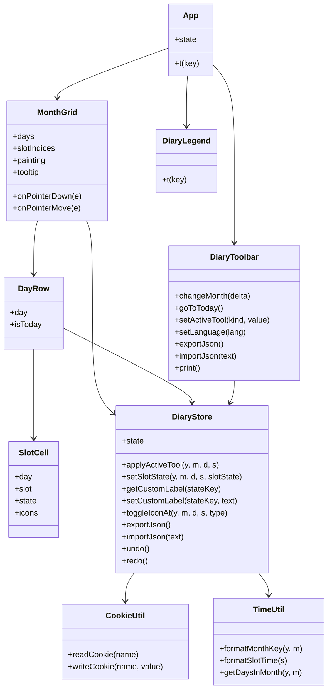

# SleepNote — Architecture

## Component tree

```
App.vue
├── DiaryToolbar.vue   — month navigation, paint tools, icons, JSON/PDF, language toggle
├── MonthGrid.vue      — month board (hour header + day rows); handles drag-paint and tooltip
│   └── DayRow.vue     — one day: date label + sleep total (HH:MM) + 48 slot cells
│       └── SlotCell.vue — one 30-minute slot: fill pattern + optional icons
└── DiaryLegend.vue    — legend of fill patterns and icons
```

## Data model

The whole diary is a single JSON document, serialized to a cookie and to exported files.

```json
{
  "version": 1,
  "customLabels": { "custom1": "Caffeine" },
  "months": {
    "2026-11": {
      "slots": { "5": "..SSSSAAD...SSSS..." },
      "icons": [ { "day": 5, "slot": 8, "type": "medication" } ],
      "notes": { "5": "Caffeine at 15:00" }
    }
  }
}
```

- `version` — schema version, currently `1`.
- `customLabels` — user-defined names for the three custom fills (`custom1`–`custom3`); a missing key falls back to the localized default name (optional; older documents omit it).
- `months` — keyed by `"YYYY-MM"` (from `TimeUtil.formatMonthKey`).
- `slots` — keyed by the day number as a string; each value is a 48-character row, one character per 30-minute slot.
- `icons` — array of `{ day, slot, type }`; `type` is `medication`, `meal`, or `coffee`.
- `notes` — keyed by the day number as a string; each value is a single-line free-text remark (optional; older documents omit it).

Slot characters (`DiaryConstants`):

| Char | State              | Kind          |
| ---- | ------------------ | ------------- |
| `.`  | Empty              | —             |
| `S`  | Sleep              | fixed fill    |
| `A`  | Awake in bed       | fixed fill    |
| `D`  | Daytime sleepiness | fixed fill    |
| `1`  | Custom 1           | user-defined  |
| `2`  | Custom 2           | user-defined  |
| `3`  | Custom 3           | user-defined  |

## State management

`Composables/DiaryStore.js` exports `useDiaryStore()`, which returns a module-level `reactive` singleton. Every component that calls it shares the same `state` object, so all views stay in sync without props/events or a state library.

`state` holds:

- `viewYear` / `viewMonth` — the visible month (`viewMonth` is 0-based).
- `language` — `en` or `ja`.
- `activeTool` — `{ kind, value }`; `kind` is `state` (Sleep / Awake in bed / Daytime sleepiness / the three user-defined fills, with Eraser mapped to Empty) or `icon` (medication / meal / coffee).
- `diary` — the document described above.
- `notice` — a transient status message.

Persistence: every mutation calls `saveDiary()`, which debounces (300 ms) a write of `JSON.stringify(state.diary)` to the `sleepnote_diary` cookie via `CookieUtil.writeCookie`. On startup, `loadDiary()` reads and parses that cookie, falling back to an empty diary on any error. `normalizeDiary()` backfills fields such as `customLabels` on older documents and imported files. The language is persisted immediately to `sleepnote_language`.

## Interaction flow

- **Drag paint** — `MonthGrid` listens for `pointerdown` / `pointermove` / `pointerup` / `pointerleave` on the board. A left-button `pointerdown` on a cell (`[data-slot]`) applies the active tool and, for state tools, records the starting day (`paintDay`) and sets `painting = true`. While `painting`, `pointermove` applies the tool to every cell entered — but only within the day row where the drag started, so an accidental drag into another day paints nothing there. Icon tools apply on a single click (no drag).
- **Right-click erase** — a `contextmenu` (right-click) on a painted slot clears its fill (`setSlotState` to `Empty`), mirroring the eraser tool; the native context menu is suppressed on the board.
- **Icon toggle** — with an icon tool active, clicking a slot calls `toggleIconAt`, which adds the icon if absent and removes it if present.
- **Sleep total** — each `DayRow` counts its own `S` (sleep) slots and shows the sum as `HH:MM` in the column after the day label. It is computed from the store on every change, so it updates while painting and on undo/redo. Only the fixed sleep fill counts; awake-in-bed, sleepiness and custom fills do not.
- **Tooltip and hover crosshair** — on `pointermove`, `MonthGrid` resolves the hovered cell with `document.elementFromPoint` and shows a tooltip such as `11/5 (Wed) 04:00`; the hovered cell's row and column are lightly highlighted (`slot-cell--highlight`) by passing the hovered day/slot down to `DayRow` / `SlotCell`.
- **Undo / Redo** — the store keeps a snapshot history (`past` / `future` stacks); mutations within 500 ms (a drag) coalesce into a single undo step. Toolbar buttons and Ctrl+Z / Ctrl+Shift+Z trigger undo/redo.

## Color theme

All colors live in CSS custom properties in `src/assets/main.css`. The `:root` block holds the light palette and the fill colors. A `@media screen and (prefers-color-scheme: dark)` block overrides them to follow the OS setting. The override is `screen`-only, so printing always uses the light palette. Components reference `var(--color-*)` and `var(--fill-*)` and never hardcode colors.

## PDF / print

PDF is produced by the browser's own print dialog (Save as PDF), not by a library: `DiaryToolbar` calls `window.print()`. `src/assets/main.css` defines an `@media print` block with `@page { size: A4 landscape; margin: 10mm }`. It hides every `.no-print` element (header, toolbar, warning) and cleans up the grid borders/overflow; the month board prints together with a compact legend so everything fits on one A4 page. `print-color-adjust: exact` forces the background fills, and the six patterns (solid / diagonal hatch / dots, plus cross-hatch / vertical stripes / checkerboard for the user-defined fills) are chosen to stay distinguishable in black and white.

## Class diagram



## Paint-drag sequence

```mermaid
sequenceDiagram
    participant U as User
    participant M as MonthGrid
    participant S as DiaryStore
    participant C as CookieUtil

    U->>M: pointerdown on [data-slot]
    M->>M: cellAt(x, y) → { day, slot }
    M->>M: painting = true; paintDay = day
    M->>S: applyActiveTool(year, month, day, slot)
    S->>S: setSlotState(...)
    S->>C: saveDiary() (debounced 300 ms)
    C->>C: writeCookie('sleepnote_diary', json)

    U->>M: pointermove within the same day row
    M->>S: applyActiveTool(...) only while day == paintDay
    S->>C: saveDiary() (debounced)

    U->>M: pointerup
    M->>M: painting = false; paintDay = null
```
